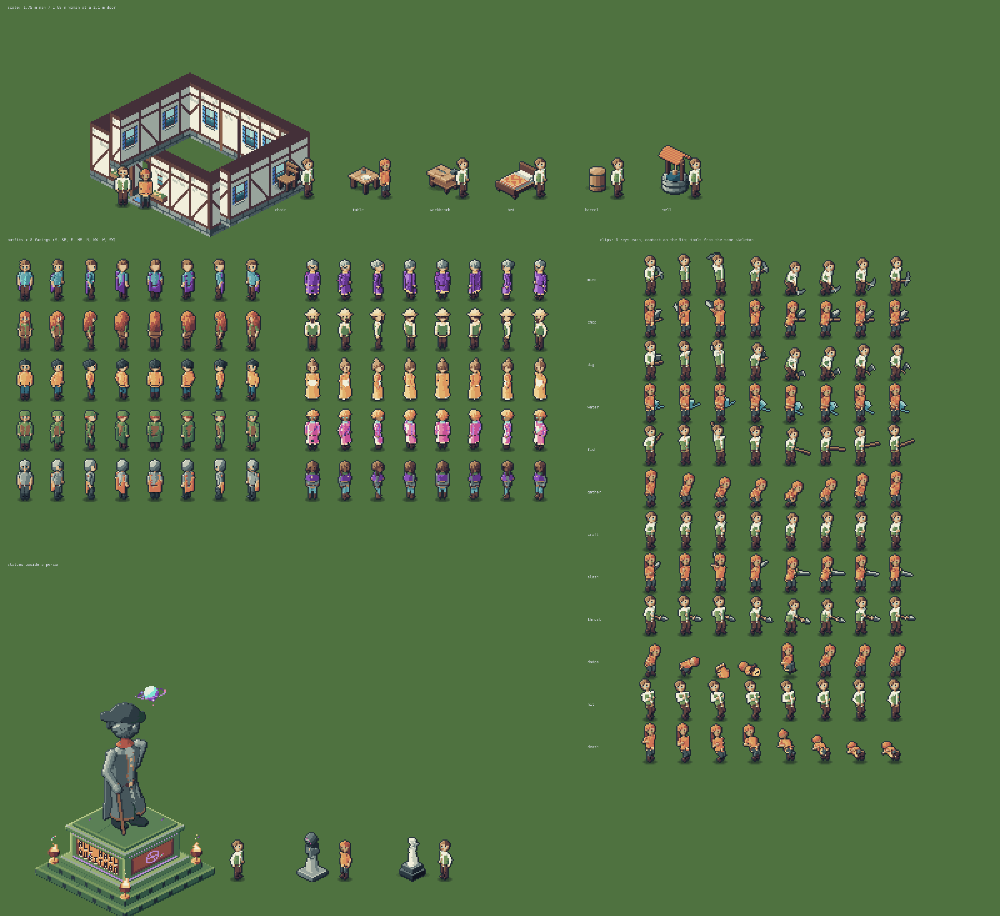

# The modular character system

Every person in Eigenlands is drawn on one of two base bodies: the player, every resident, traveller, guard and
royal, and the humanoid statues too. Clothes, armour, hair and held items are layers on that body, and each
animation is a pose of one shared skeleton. Code: `packages/client/src/art/body/`. References:
`assets/reference/characters/` (the male and female walk sheets, hair, eyes and mouths).

## Scale calibration

The world fixes the scale; buildings were not resized.

- **Camera:** the 2:1 dimetric view (`sx = (x − y)·16`, `sy = (x + y)·8`) is a 30° look-down. Heights map 1:1 to screen
  pixels.
- **Units:** a tile edge stands for about 1.2 m, and a door opening is 34 px tall (`buildings.ts`, `z < 34`). That makes
  one vertical metre about 16.3 px, so the door is about 2.1 m and a 44 px wall about 2.7 m.
- **Adults:** a man of 1.78 m is **29 px** from sole to crown, and a woman of 1.68 m is **28 px**. Both clear a doorway
  with about a third of a metre of headroom.
- **Old people were too tall:** they stood about 38 px, roughly 30 % over this scale, and taller than the doors.
- **Check:** downscaling the reference sheets to 29/28 px keeps their head-to-body ratio. A head is 8 px, about 3.6
  heads to the body, as in the references.
- **Other figures:** children use `Outfit.shorten`, which shrinks the limbs and torso but keeps the head size. Statues
  are drawn with a magnification: QubitMan's monument is ×3.2, the crypt figure ×1, and the garden statue ×0.75 on its
  plinth.
- **Cell:** people share one 32×48 cell, NPCs included. Feet sit at row 45 and the sprite is anchored bottom-centre.
  Name labels sit 36 px above the base (`PERSON_TOP`), just over the head.

## How a frame is made

1. **Pose** (`poses.ts`): each frame id maps to a skeleton pose. These are idle and breathing (0/9), walk (1–8), run
   (14–21), the legacy strike, aim and cast clips (10–13, 22–29), and every action family in `person-actions.ts`. A pose
   sets the hips, lean, twist, hands, feet and tool direction.
2. **Joints** (`skeleton.ts`): two-bone IK solves knees and elbows. Feet stay where the pose plants them, so a crouch
   bends the legs instead of shrinking the figure. Limb lengths and torso cross-sections are measured from the
   references, per body.
3. **Surfaces** (`paint.ts`): each surface is sampled in body space, projected with the game camera, and z-buffered. The
   surfaces are:
   - the torso as stacked elliptical cross-sections;
   - the limbs as capsules;
   - the hands and feet;
   - capes as cloth sheets;
   - skirts and robes as hollow cones that widen to contain the stride.

   This is why the far arm passes behind the body, a cape hangs behind the back and a skirt covers the thighs, in all
   eight facings and in every pose.

4. **Layers:** a garment is chosen by where a sample lies on the body:
   - the height on the torso (shirt hem, belt, vest, breastplate, sash, apron);
   - the distance down the arm (sleeve length, gloves);
   - the height of a leg point (trousers, boots and their cuffs).

   Under clothes the body is simply not shown. Without clothes, both bodies wear plain underwear.

5. **Head:** the face is the reference's own pixel map for each facing, cleaned by hand (`heads.ts`). Hair, hats and
   beards are small volumes around the skull, ray-cast per facing (`headwear.ts`), so a ponytail or a hood reads
   correctly from behind as well as from the front. There are 29 cuts, 11 hats and 6 beard styles. Statues get a carved
   head instead, with a modelled nose and eye sockets.
6. **Shading:** each sample is lit from its normal, with the key light from the upper left like the rest of the world.
   Where a nearer part overlaps a farther one, a contact shadow separates them. The sprite then gets the same outline
   and rim polish as before.

Held tools and weapons take the hand position and the shaft angle from the same solved skeleton
(`personGripOf`), so they cannot drift off the grip.

## Animation

- **Timing:** work and combat clips have four key poses: set-up, anticipation, contact and recovery. They are sampled at
  the eight key positions the game already uses, with contact at key 2. Sounds, particles and resource changes fire from
  the game's existing timers, so they stay tied to that key across frame rates and interruptions.
- **Gait:** the walk uses a 3 px stride and the run 4.4 px, with a heel strike, a passing pose at the top of the bounce,
  and the opposite arm forward. Running adds a forward lean and bent elbows.
- **Clips:**

  | Group                 | Clips                                                                   |
  | --------------------- | ----------------------------------------------------------------------- |
  | Gathering and farming | mine, chop, dig/hoe, water, fish (cast / bite / wait), gather and plant |
  | Crafting              | craft, forge, cook, alchemy, saw                                        |
  | Movement and social   | channel, sit, swim, talk                                                |
  | Combat                | hit, slash, thrust, cleave, shot, cast                                  |
  | Dodge and death       | a forward roll, and a fall                                              |

- **Dodge:** the roll plays through the dash (180 ms, with its existing invulnerability), then a short rise. The
  translucent ghosting is gone.
- **Death:** the body falls away from the camera, so it stays inside its cell in every facing.

## Residents

Residents keep their names, roles, schedules, dialogue and behaviour, and their existing outfits (`NPC_LOOKS`, realm
looks, settlement looks). Only the body under them changed. The body type follows the pronouns in each resident's own
bio (`bodyFromBio`). Haircuts follow their old hair style, and absent styles get a stable per-person default.

## Appearance

The packed appearance gains `body` (bit 25) and `cut` (bits 26–30, where 0 means the classic style). Both sit above
the original 24 bits and the "chosen" flag, so every look saved before this decodes unchanged
(`shared/test/appearance.test.ts`). The character creator offers Body and Haircut.

## Statues

| Statue                    | Kept                                                                                                                   | Changed                                          |
| ------------------------- | ---------------------------------------------------------------------------------------------------------------------- | ------------------------------------------------ |
| QubitMan (Hadamere plaza) | Tricorn, red scarf, open coat with tails and gold buttons, cane, floating orb, braziers, plinth, inscription and runes | Anatomy; drawn at ×3.2                           |
| Crypt statue              | Hood, robe, folded hands, glowing eyes and plinth                                                                      | Anatomy, at life size                            |
| Garden statue             | Its pedestal and style materials                                                                                       | Now a robed figure lifting an offering, at ×0.75 |

Shadows, sorting and collision come from their props as before.

## Creatures

All creature paths share the `contour` step (`creature-pixels.ts`). It now draws one dark outline all the way around
every silhouette, matching the people and the reference animals. The bestiary atlases were re-baked with it
(`e2e/bestiary-art.mjs --bake`).

## Validation

| Check                                           | Result                                                                                                                                                                                                                                  |
| ----------------------------------------------- | --------------------------------------------------------------------------------------------------------------------------------------------------------------------------------------------------------------------------------------- |
| Review board (`labs/spritelab.html?lab=review`) | Shows both bodies at a real cottage door and beside furniture, outfits in eight facings, twelve clips with the tool in hand, and the statues next to a person                                                                           |
| Unit tests                                      | Client 197, shared 350, server 396: all passing                                                                                                                                                                                         |
| Server test environment                         | Needs Postgres and Redis running                                                                                                                                                                                                        |
| In-world screenshots                            | [player at a door](validation/characters/player-at-door.png), [village residents](validation/characters/village-npcs.png), [statues](validation/characters/statues.png), [creature outline](validation/characters/creature-outline.png) |

## Not finished

- **Hair:** the hair sheet's 50 front-view styles were used as a guide, not traced one by one. The 29 cuts are modelled
  volumes so that they work in all 8 facings.
- **Clothing references:** the attached shirt, trouser and boot sheets set the layer vocabulary and colours, which is
  every layer listed above. Their per-item details (patches, pouches, quilting, fur trims) are not modelled.
- **Mouths:** the eyes come from the reference heads. The mouths sheet's ten expressions are not wired; there is one
  neutral mouth.
- **Missing poses:** there is no carry pose and no separate reel and land fishing poses, because the game has no state
  that shows them yet.
- **Animal models:** the creature style pass is the shared outline only. The animals are not yet remodelled one by one
  against the wildlife and farm reference sheets (proportions, faces, fur patterns).
- **World art:** houses, crop tiles, trees and rocks are not yet restyled to their reference sheets.
- **Riders:** mounts keep their rider offsets, but the reference mounted-rider sheet (legs straddling the saddle) is not
  yet a pose.
